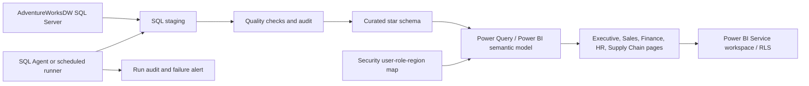

# Enterprise Business Intelligence Suite for a Multi-Region Company

A reproducible SQL Server and Power BI reference implementation using AdventureWorksDW as its analytical source. It combines sales and inventory facts with governed, region-aware reporting patterns for finance, HR, and supply chain.

## Business problem and users

Sales, finance, workforce, and inventory reporting often live in separate systems and arrive on different schedules. This project creates a conformed analytical layer and a documented semantic model so executives can compare performance while regional users see only their assigned territory. Personas are CEO (cross-region KPIs), CFO (financial measures), regional sales manager (assigned territory), HR manager (aggregated workforce measures), supply-chain manager (inventory), and analyst (authorized detail).

## Status and scope

This repository contains executable SQL Server scripts, Power Query M templates, a DAX measure library, security design, a Python validation suite, and deployment/presentation documentation. It does **not** contain a fabricated PBIX, screenshots, Power BI Service publication, or actual refresh logs. Those require Windows Power BI Desktop and a licensed tenant. HR, budget/targets, and finance data are not present in all AdventureWorksDW releases; scripts explicitly identify these limitations and do not invent employee-sensitive records or financial facts. See [known limitations](docs/deployment_guide.md#known-limitations).

## Architecture

The runnable local implementation is SQL Server staging and curated tables plus Power BI Desktop. [ADF migration notes](azure_data_factory/pipeline_design.md) map these activities to a production pipeline.

## Repository layout

- `sql/`: ordered database setup, staging, load, quality, star-schema, security, analytics, and audit scripts.
- `power_query/`: M templates and transformation notes.
- `power_bi/`: DAX library, model relationships, page specification, RLS design.
- `docs/`: architecture, dictionary, metrics, access matrix, one-page PDF user guide, tests, deployment.
- `tests/`: SQL validation and Python business-rule tests.
- `azure_data_factory/`: local scheduler and ADF production design.
- `presentation/`: editable PowerPoint deck, 10-minute talk track, reflection template, and deck builder.

## Prerequisites

- SQL Server 2019+ (Developer or Express for local work) and SSMS or `sqlcmd`.
- Microsoft AdventureWorksDW sample database, restored as `AdventureWorksDW` (Microsoft backup releases vary; use the DW backup matching your SQL Server version).
- Power BI Desktop on Windows for the `.pbix` authoring steps.
- Python 3.10+ only for the pure calculation tests.

## Setup and run

1. Restore the official AdventureWorksDW backup using SQL Server/SSMS. Do not run the scripts against a production database.
2. Open and run `sql/01_create_database.sql` through `sql/10_create_audit_logs.sql` in numeric order. Set the database name and source schema as needed for your restored release. `02` and `03` create local stage tables and load supported DW source tables; the curated build uses those tables.
3. Review `sql/04_data_quality_checks.sql` results. Resolve or document exceptions before refreshing the semantic model.
4. Connect Power BI Desktop to the curated database and follow `power_query/power_query_documentation.md`. Enable load only for model queries and verify query folding on SQL-backed tables.
5. Add measures from `power_bi/dax_measures.md`; create relationships per `power_bi/semantic_model.md`; configure roles per `power_bi/rls_configuration.md`.
6. Build pages from `power_bi/dashboard_specification.md`. Save the resulting local report as `power_bi/enterprise_bi_suite.pbix`.
7. For local scheduled movement, configure SQL Server Agent using `azure_data_factory/sql_agent_job.md`; for Power BI cloud refresh follow `docs/deployment_guide.md`.
8. Run Python checks from repository root: `python -m unittest discover -s tests -v`. SQL-side checks are in `tests/sql_validation_tests.sql`.

## Source restoration

Download the AdventureWorksDW backup from Microsoft's official SQL Server sample databases repository and restore it in SQL Server. The exact file name and compatibility level vary by release; consult the release README that accompanies the chosen backup. This project assumes DW dimension and fact naming such as `dbo.FactInternetSales`, `dbo.DimDate`, and `dbo.DimProduct`. Verify object names first with `SELECT TABLE_SCHEMA,TABLE_NAME FROM AdventureWorksDW.INFORMATION_SCHEMA.TABLES`.

## Refresh and access

Local SQL load scheduling is described in `azure_data_factory/sql_agent_job.md`. Power BI Service gateway, credentials, workspace roles, dataset refresh, and RLS assignment are documented in `docs/deployment_guide.md`. Never commit credentials or real user emails. Sample identities use `example.com` only.

Architecture diagram: [SVG](docs/architecture_diagram.svg) | User guide: [PDF](docs/user_guide.pdf) | Presentation: [PowerPoint](presentation/final_presentation.pptx). The Executive Summary and monthly review PDFs are omitted because no source database was available to compute evidence-backed results.

## Reproduction boundaries

The scripts provide a functional baseline, not a universal installer: AdventureWorksDW versions differ, and SQL Server permissions/edition differ. The base sample has no complete operational HR or target/budget dataset. Workforce and target pages therefore require a separately approved source before becoming populated. No sensitive salary, national ID, birth date, address, or direct-contact columns are selected into the reporting model.

Final verification checklist: [docs/final_qa_checklist.md](docs/final_qa_checklist.md).
