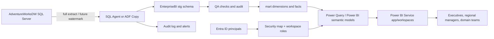

# Architecture and data flow

Refresh flow: scheduled runner executes `audit.usp_RunRefresh`; staging and curated loads are transactional per procedure; failures are recorded and rethrown for scheduler notification; QA is reviewed before semantic model refresh. SQL Server Agent history plus `audit.PipelineRun` is the local monitoring path. ADF production version uses linked service, copy activity, stored procedure activity, failure branch, and monitor alerts.

Security flow: Entra ID authenticates user; Power BI workspace/app grants access to the relevant domain model; dynamic mapping filters regional data. Data model isolation provides domain boundaries that RLS alone cannot enforce.
