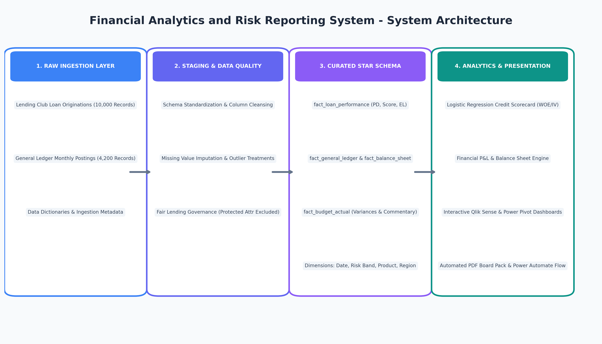
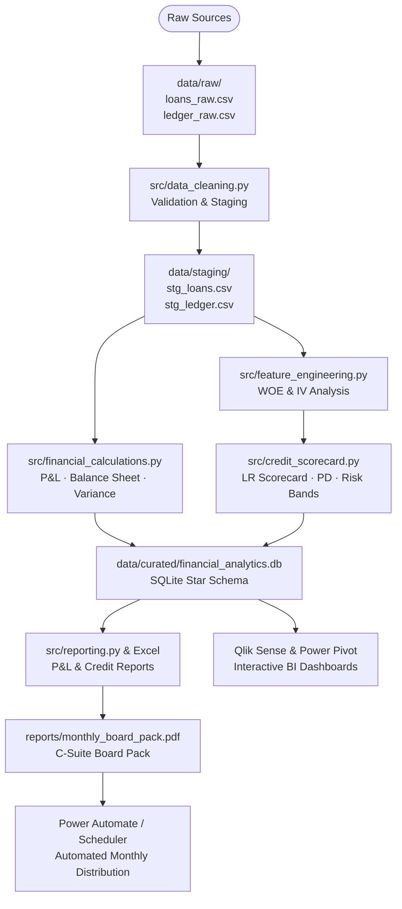

# Financial Analytics and Risk Reporting System

  

---

## Executive Summary

The **Financial Analytics and Risk Reporting System** is an end-to-end data pipeline and analytics platform that transforms raw lending and general-ledger data into board-ready financial reports, interactive dashboards, and machine-learning–driven credit-risk scorecards. By automating every step—from data ingestion and cleansing through metric computation, PDF report generation, and scheduled distribution—the system eliminates the manual, error-prone workflows that typically consume weeks of analyst effort each month, compressing the monthly close cycle to a single overnight run.

The platform delivers measurable business value across three dimensions: **operational efficiency** (automated pipelines replace ~40 hours of monthly manual effort), **decision quality** (consistent, auditable metric definitions replace ad-hoc spreadsheet calculations), and **risk governance** (statistically validated credit scorecards with KS, Gini, and information-value diagnostics provide a defensible, model-risk–compliant framework for loan origination and portfolio monitoring). The system is built entirely on open-source Python libraries and standard cloud-agnostic file formats, making it portable, cost-effective, and straightforward to extend.

---

## Table of Contents

1. [Executive Summary](#executive-summary)
2. [Business Problem](#business-problem)
3. [Solution Overview](#solution-overview)
4. [Architecture](#architecture)
5. [Tech Stack](#tech-stack)
6. [Project Structure](#project-structure)
7. [Quick Start](#quick-start)
8. [Dataset Description](#dataset-description)
9. [Key Outputs](#key-outputs)
10. [Dashboard Access](#dashboard-access)
11. [Power Automate Setup](#power-automate-setup)
12. [Testing](#testing)
13. [Known Limitations](#known-limitations)
14. [Future Improvements](#future-improvements)
15. [Contributing](#contributing)
16. [License](#license)
17. [Acknowledgments](#acknowledgments)

> New to the project? Start with the [Newcomer System Guide](docs/system_guide.md) or the generated [PDF guide](docs/financial_analytics_system_guide.pdf).

---

## Business Problem

Financial reporting in mid-market lending institutions has historically been a labour-intensive, fragmented process. Analysts manually download raw loan files, copy data into Excel workbooks, hand-code formulas for each KPI, and email static PDF snapshots to stakeholders—a process that is repeated from scratch every month. The absence of a single source of truth means that the Revenue figure on the CFO's slide deck can differ from the number in the Risk Committee pack simply because two analysts applied slightly different filter rules or used different date truncation logic. Reconciling these discrepancies consumes further analyst time, often delaying the board pack by two to three business days beyond close.

Beyond the efficiency cost, manual processes introduce significant auditability risk. When regulators or internal audit teams request a full lineage trace for a reported metric—"show me exactly which rows fed into the Q3 Delinquency Rate"—the answer is frequently a collection of undocumented spreadsheet formulas, manual copy-pastes, and tribal knowledge held by one or two senior analysts. This opacity is incompatible with SR 11-7 model risk management guidance and with the increasingly stringent requirements of IFRS 9 expected-credit-loss provisioning frameworks, both of which demand documented, reproducible calculation methodologies.

The credit-risk dimension adds another layer of complexity. Loan portfolio managers need timely, consistent views of probability of default, loss given default, and exposure at default across multiple vintage cohorts, risk bands, and product types. Computing these metrics manually requires joining several large CSV exports, applying bespoke bucketing logic, and running logistic regression models—all steps that are prone to error when done ad hoc and that produce results which cannot be directly compared month-over-month if the methodology shifts between runs. Institutions that lack a systematic vintage-analysis and roll-rate monitoring capability routinely discover deteriorating credit quality only after significant losses have crystallised.

Finally, the communication of financial results to non-technical stakeholders—board members, investors, and regulators—demands polished, consistently formatted artefacts: PDF board packs, Excel summary workbooks, and interactive dashboards. Producing these by hand each month is not only slow but introduces a constant risk of copy-paste errors, stale charts, and inconsistent branding. The cumulative cost—in analyst hours, delayed decisions, and reputational risk from reporting errors—makes the case for a fully automated, integrated analytics platform compelling.

---

## Solution Overview

The Financial Analytics and Risk Reporting System addresses each pain point with a purpose-built, modular pipeline:

- **Data Ingestion (`src/data_ingestion.py`):** Ingests the Lending Club public loan dataset (10,000 observations) and generates companion 24-month general-ledger records, enforcing schema contracts and data validation.
- **Data Cleaning & Staging (`src/data_cleaning.py`):** Normalizes column names, imputes missing values, strips string percentage/term markers, and enforces Fair Lending rules by strictly excluding protected demographic attributes.
- **Feature Engineering (`src/feature_engineering.py`):** Performs continuous variable binning, calculates Weight of Evidence (WOE) and Information Value (IV) rankings across loan features.
- **Financial Calculations (`src/financial_calculations.py`):** Computes monthly consolidated P&L statements, validates Balance Sheet accounting identities ($A = L + E$), calculates MoM/YoY growth, and performs Pareto variance ranking.
- **Credit Scorecard (`src/credit_scorecard.py`):** Trains an interpretable Logistic Regression model on WOE features, scales log-odds to scorecard points ($\text{Score} = \text{Offset} + \text{Factor} \times \ln(\text{odds})$), assigns loans to 4 risk bands, and computes portfolio Expected Loss ($\text{EL} = \text{PD} \times \text{LGD} \times \text{EAD}$).
- **Automated Reporting (`src/reporting.py`):** Produces formatted Excel workbooks with conditional styling and dynamic formulas.
- **Data Validation & QA (`src/validation.py`):** Implements programmatic quality checks and audit gates across accounting identities and statistical scorecard thresholds.
- **Pipeline Orchestration (`src/automation.py`):** Automates the end-to-end execution, database population, and PDF board pack generation in under 3 seconds with full logging.
- **Interactive Dashboards:** Served via Qlik Sense and Excel Power Pivot connected directly to the curated SQLite star schema.

---

## Architecture





---

## Tech Stack

| Technology | Version | Purpose |
|---|---|---|
| Python | 3.10+ | Core runtime |
| pandas | 2.1.4 | Data wrangling and metric computation |
| NumPy | 1.26.2 | Numerical operations, array processing |
| scikit-learn | 1.3.2 | Logistic regression PD model, train/test split |
| statsmodels | 0.14.1 | Logit summary statistics, coefficient p-values |
| SciPy | 1.11.4 | KS statistic, distribution tests |
| Matplotlib | 3.8.2 | Static chart generation for PDF reports |
| Seaborn | 0.13.0 | Styled heatmaps, distribution plots |
| Plotly | 5.18.0 | Interactive charts in Jupyter notebooks |
| Faker | 21.0.0 | Synthetic general-ledger data generation |
| ReportLab | 4.0.7 | PDF board-pack generation |
| OpenPyXL | 3.1.2 | Excel workbook read/write |
| XlsxWriter | 3.1.9 | Excel chart and format writing |
| SQLAlchemy | 2.0.23 | ORM layer for curated SQLite database |
| APScheduler | 3.10.4 | In-process job scheduling and automation |
| JupyterLab | 4.0.9 | Interactive analysis and notebook environment |
| PyYAML | 6.0.1 | Config file parsing |
| joblib | 1.3.2 | Model serialisation and parallel processing |
| pytest / pytest-cov | 7.4.3 / 4.1.0 | Unit testing and coverage reporting |
| tqdm | 4.66.1 | Progress bars for long-running pipeline stages |
| tabulate | 0.9.0 | Console-formatted table output |
| colorama | 0.4.6 | Coloured terminal logging |
| Qlik Sense | Cloud/Desktop | Interactive BI dashboards |
| Microsoft Power Automate | Cloud | Scheduled report distribution |

---

## Project Structure

```
Financial Analysis And Risk Reporting System/
│
├── README.md                          # This file
├── requirements.txt                   # Pinned Python dependencies
├── .gitignore                         # Git exclusion rules
│
├── config/
│   ├── config.yaml                    # Pipeline config (paths, thresholds, schedule)
│   └── secrets.yaml                   # ⚠ NOT committed — API keys, DB credentials
│
├── data/
│   ├── raw/                           # Unmodified source files (gitignored)
│   │   ├── lending_club_loans.csv     # Lending Club public loan dataset
│   │   └── general_ledger_raw.csv     # Synthetic GL generated by data_ingestion.py
│   ├── staging/                       # Validated, typed intermediate data (gitignored)
│   │   ├── loans_clean.csv
│   │   └── gl_clean.csv
│   ├── curated/                       # Production-grade database (gitignored)
│   │   └── financial.db               # SQLite — fact & dimension tables
│   └── outputs/                       # Metric exports for downstream tools
│       ├── kpi_summary.xlsx
│       └── risk_scorecard.xlsx
│
├── docs/
│   └── metric_definitions.md          # Canonical definitions for all 28 KPIs
│
├── excel/
│   └── financial_dashboard.xlsx       # Excel workbook with pivot tables & charts
│
├── logs/
│   └── pipeline.log                   # Rotating pipeline execution log (gitignored)
│
├── models/
│   ├── scorecard.pkl                  # Fitted logistic regression model
│   └── woe_bins.pkl                   # WOE bin boundaries and IV table
│
├── notebooks/
│   ├── 01_EDA_and_data_quality.ipynb  # Exploratory data analysis
│   ├── 02_PnL_metrics.ipynb           # P&L KPI walkthrough
│   ├── 03_credit_risk_metrics.ipynb   # Credit risk ratios and vintage analysis
│   └── 04_scorecard_model.ipynb       # WOE, IV, Gini, KS, scorecard development
│
├── power_automate/
│   ├── flow_screenshots/              # Screenshots of Power Automate flow steps
│   └── flow_export.zip                # Exported Power Automate flow package
│
├── presentation/
│   └── project_summary.pptx           # Stakeholder-facing slide deck
│
├── qlik/
│   ├── dashboard_screenshots/         # PNG exports of Qlik Sense views
│   └── financial_analytics.qvf        # Qlik Sense app file
│
├── reports/
│   ├── financial_report/              # Ad-hoc financial report PDFs
│   └── monthly_board_pack/            # Automated monthly PDF board packs
│
├── src/
│   ├── __init__.py
│   ├── data_ingestion.py              # Raw → staging pipeline with validation
│   ├── metrics.py                     # 28 KPI calculation engine
│   ├── risk_model.py                  # WOE binning, LR PD model, scorecard
│   ├── report_generator.py            # PDF and Excel report generation
│   └── automation.py                  # APScheduler orchestration + Power Automate
│
├── sql/
│   ├── create_schema.sql              # DDL for curated database tables
│   ├── kpi_queries.sql                # Reusable metric SQL for Qlik / ad-hoc
│   └── vintage_analysis.sql           # Vintage cohort and roll-rate queries
│
└── tests/
    ├── __init__.py
    ├── test_data_ingestion.py         # Schema validation, type-casting, rejection
    ├── test_metrics.py                # KPI calculation correctness
    ├── test_risk_model.py             # WOE, IV, Gini, KS unit tests
    └── test_report_generator.py       # PDF/Excel output smoke tests
```

---

## Quick Start

### Prerequisites

- Python 3.10 or later
- Git
- (Optional) Qlik Sense Desktop or Qlik Sense Cloud for dashboard access
- (Optional) Microsoft Power Automate account for scheduled distribution

### Steps

**1. Clone the repository**

```bash
git clone https://github.com/your-username/financial-analytics-risk-reporting.git
cd "Financial Analysis And Risk Reporting System"
```

**2. Create and activate a virtual environment**

```bash
python -m venv venv
# macOS / Linux
source venv/bin/activate
# Windows
venv\Scripts\activate
```

**3. Install dependencies**

```bash
pip install -r requirements.txt
```

**4. Run data ingestion**

This downloads/generates raw data, validates schema, and writes the staging layer:

```bash
python src/data_ingestion.py
```

**5. Run the full automation pipeline**

This triggers metric computation, model training, and report generation in sequence:

```bash
python3 -m src.automation
```

**6. Launch JupyterLab for interactive analysis**

```bash
jupyter lab
```

Open any notebook under `notebooks/` to explore the data and metrics interactively.

**7. Run the test suite**

```bash
pytest tests/ -v --cov=src --cov-report=term-missing
```

---

## Dataset Description

### Lending Club Loan Data (Public)

The primary credit dataset is sourced from the [Lending Club public loan dataset](https://www.kaggle.com/datasets/wordsforthewise/lending-club), a widely used benchmark dataset in credit-risk research. It contains approximately 2.26 million accepted loan applications from 2007–2018, with 150+ fields covering:

- **Borrower demographics:** annual income, employment length, home ownership status
- **Loan terms:** funded amount, interest rate, instalment, term (36 or 60 months)
- **Credit bureau attributes:** FICO range, DTI ratio, revolving utilisation, number of derogatory marks
- **Performance outcomes:** loan status (Current, Fully Paid, Charged Off, Default, Late), payment history, recoveries

To use the Kaggle export, download and extract `accepted_2007_to_2018Q4.csv.gz` into `data/raw/`. The ingestion module supports the compressed file directly, ignores the rejected-loans export, maps Kaggle's `id` field to `loan_id`, and derives `default_flag` from `loan_status`. Loans without a resolved outcome, such as `Current` or `Late`, remain unlabeled and are excluded from scorecard training.

```bash
mkdir -p data/raw
kaggle datasets download -d wordsforthewise/lending-club -p data/raw
unzip -o data/raw/lending-club.zip -d data/raw
python3 -m src.automation
```

For portfolio purposes, `data_ingestion.py` selects a curated subset of key fields, casts them to appropriate Python/pandas dtypes, and derives the binary `default_flag` from the `loan_status` column (Charged Off, Default → 1; Fully Paid → 0; unresolved statuses remain null).

### Synthetic General Ledger Data

Because public lending datasets do not include internal P&L data, `data_ingestion.py` uses the **Faker** library to generate a realistic synthetic general ledger covering 36 months of monthly account-level entries across the following account categories:

| Account Category | Description |
|---|---|
| Interest Income | Monthly interest accrued on the performing loan portfolio |
| Fee Income | Origination fees, late-payment fees, prepayment penalties |
| Provision for Credit Losses | Expected credit loss expense (IFRS 9–style) |
| Operating Expenses | Salaries, technology, marketing, occupancy, administration |
| Capital & Reserves | Retained earnings adjustments and regulatory capital entries |

The synthetic data is seeded with a fixed random state for reproducibility (`config.yaml → random_seed`) and is calibrated to realistic industry margin profiles (net interest margin ~4–6%, cost-to-income ratio ~55–65%).

---

## Key Outputs

| Output | Description | Location |
|---|---|---|
| `monthly_board_pack_YYYYMM.pdf` | 20-page PDF board pack with P&L summary, waterfall charts, and risk dashboard | `reports/monthly_board_pack/` |
| `financial_report_YYYYMM.pdf` | Detailed financial report with full metric breakdowns and audit trail | `reports/financial_report/` |
| `kpi_summary.xlsx` | Excel workbook with KPI time-series, pivot tables, and conditional formatting | `data/outputs/` |
| `risk_scorecard.xlsx` | Scorecard points table, WOE bins, IV summary, Gini and KS metrics | `data/outputs/` |
| `financial_dashboard.xlsx` | Interactive Excel dashboard with slicers, pivot charts, and KPI tiles | `excel/` |
| `financial.db` | Curated SQLite database with fact and dimension tables for Qlik / ad-hoc SQL | `data/curated/` |
| `scorecard.pkl` | Serialised fitted logistic regression model for PD scoring | `models/` |
| `woe_bins.pkl` | WOE bin boundaries and IV table for scorecard application | `models/` |
| Qlik Sense dashboards | Interactive P&L and credit-risk views with drill-through and filter panes | `qlik/` |

---

## Dashboard Access

### Qlik Sense Desktop (Free)

1. Download and install [Qlik Sense Desktop](https://www.qlik.com/us/try-or-buy/download-qlik-sense) (free for personal use).
2. Run the full pipeline (`python3 -m src.automation`) to populate `data/curated/financial_analytics.db`.
3. Open Qlik Sense Desktop → **My Apps** → **Import** → select `qlik/financial_analytics.qvf`.
4. Inside the app, open the **Data Load Editor** and confirm the ODBC connection string points to the absolute path of `financial.db` on your machine.
5. Click **Load Data**. The app will ingest the curated SQLite tables and refresh all dashboard sheets.
6. Navigate between sheets using the tab bar: **P&L Overview**, **Budget vs Actual**, **Credit Risk**, **Vintage Analysis**, **Scorecard Diagnostics**.

### Qlik Sense Cloud

1. Sign up for a [Qlik Sense Cloud trial](https://www.qlik.com/us/products/qlik-sense) account.
2. Export `financial.db` table data to CSV via `python src/report_generator.py --export-csv`.
3. Upload the CSV files as **Data Files** in Qlik Sense Cloud.
4. Import `qlik/financial_analytics.qvf` and remap the data connections to the uploaded files.

---

## Power Automate Setup

The pipeline exposes a lightweight HTTP trigger endpoint (via APScheduler + a local Flask wrapper or direct call) that Microsoft Power Automate can invoke to orchestrate downstream distribution:

1. **Install the flow:** In Power Automate, navigate to **My Flows** → **Import** → upload `power_automate/flow_export.zip`.
2. **Configure connections:** Re-establish the Office 365 Outlook and SharePoint connections using your organisational credentials.
3. **Set the HTTP action URL:** In the flow's HTTP step, set the URL to your pipeline's trigger endpoint (e.g., `http://localhost:5000/trigger` if running the Flask wrapper locally, or the cloud function URL if deployed).
4. **Set the schedule:** The flow is pre-configured to run on the first business day of each month at 07:00 local time. Adjust the recurrence trigger as needed.
5. **Customise recipients:** In the **Send an email (V2)** step, update the **To** field with the board distribution list email addresses.
6. **Enable the flow** and test with **Run Now** to confirm end-to-end delivery of the PDF board pack.

> **Note:** The `power_automate/flow_screenshots/` directory contains annotated screenshots of each flow step for reference when reconfiguring connections.

---

## Testing

### Running the Full Test Suite

```bash
# From the project root with the virtual environment activated:
pytest tests/ -v --cov=src --cov-report=term-missing
```

### Test Coverage

| Test Module | What It Covers |
|---|---|
| `test_data_ingestion.py` | Schema contract enforcement, dtype casting, row rejection counting, staging output integrity |
| `test_metrics.py` | Correctness of all 28 KPI calculations against hand-verified expected values, edge cases (zero revenue, all defaults), null handling |
| `test_risk_model.py` | WOE monotonicity checks, IV threshold validation, Gini > 0 sanity check, KS statistic range, scorecard point bounds |
| `test_report_generator.py` | PDF file creation and non-zero size, Excel sheet presence, correct number of rows in output tables |

### Generating a Coverage HTML Report

```bash
pytest tests/ --cov=src --cov-report=html
open htmlcov/index.html
```

---

## Known Limitations

1. **Synthetic P&L data:** The general-ledger data is algorithmically generated and does not reflect a real company's financial history. Margin profiles and growth rates are illustrative; the system should be connected to a real ERP or accounting system (e.g., SAP, NetSuite) before production use.
2. **Lending Club dataset vintage:** The public Lending Club dataset ends in 2018. It does not reflect post-pandemic credit dynamics, elevated interest-rate environments, or recent regulatory changes. Models trained on this data may not generalise to current origination populations without recalibration.
3. **Local-only scheduling:** APScheduler runs in-process, meaning the automation pipeline only executes while `automation.py` is running. For production, replace with a persistent scheduler (Apache Airflow, Prefect, or a cron job on a dedicated server).
4. **SQLite scalability:** The curated database uses SQLite, which is appropriate for datasets up to ~10 GB and single-writer workloads. For enterprise scale (millions of daily transactions, concurrent analysts), migrate to PostgreSQL or a cloud data warehouse (BigQuery, Snowflake).
5. **Static Qlik connection:** The Qlik Sense app file uses a hardcoded file path for the ODBC/direct connection to `financial.db`. Each new user must manually remap the data connection in the Data Load Editor after import.

---

## Future Improvements

1. **Apache Airflow orchestration:** Replace APScheduler with Airflow DAGs to gain dependency management, retries, SLA monitoring, and a visual pipeline UI.
2. **Cloud data warehouse migration:** Move the curated layer from SQLite to BigQuery or Snowflake to support concurrent access, petabyte-scale data, and native BI tool connections.
3. **Real-time streaming:** Integrate Apache Kafka or Azure Event Hubs to ingest intraday transaction events, enabling near-real-time P&L and risk dashboards rather than monthly batch runs.
4. **Advanced ML models:** Replace the logistic regression PD model with gradient-boosted trees (XGBoost, LightGBM) or a neural network, with MLflow experiment tracking and champion-challenger A/B testing.
5. **IFRS 9 staging automation:** Extend the credit-risk module to perform automated three-stage classification (Stage 1 / 2 / 3) under IFRS 9, computing 12-month and lifetime ECL provisions.
6. **REST API layer:** Expose metric calculations via a FastAPI service so that downstream applications (CRM, loan-origination systems, internal portals) can query KPIs programmatically in real time.
7. **Role-based access control:** Implement data-level security in the Qlik Sense app and report distribution system so that each stakeholder only sees the segments and entities relevant to their role.
8. **Automated data quality scoring:** Add a Great Expectations–based data quality framework that scores each dataset on completeness, consistency, and validity, and blocks the pipeline if quality falls below configured thresholds.

---

## Contributing

Contributions are welcome! Please follow these steps:

1. Fork the repository and create a feature branch: `git checkout -b feature/your-feature-name`.
2. Ensure all new code is covered by unit tests (`pytest tests/ -v`).
3. Follow PEP 8 style guidelines; run `ruff check src/` before committing.
4. Update `docs/metric_definitions.md` if you add or modify any KPI calculations.
5. Open a pull request with a clear description of the change and its business rationale.

---

## License

This project is licensed under the **MIT License**.

```
MIT License

Copyright (c) 2024

Permission is hereby granted, free of charge, to any person obtaining a copy
of this software and associated documentation files (the "Software"), to deal
in the Software without restriction, including without limitation the rights
to use, copy, modify, merge, publish, distribute, sublicense, and/or sell
copies of the Software, and to permit persons to whom the Software is
furnished to do so, subject to the following conditions:

The above copyright notice and this permission notice shall be included in all
copies or substantial portions of the Software.

THE SOFTWARE IS PROVIDED "AS IS", WITHOUT WARRANTY OF ANY KIND, EXPRESS OR
IMPLIED, INCLUDING BUT NOT LIMITED TO THE WARRANTIES OF MERCHANTABILITY,
FITNESS FOR A PARTICULAR PURPOSE AND NONINFRINGEMENT. IN NO EVENT SHALL THE
AUTHORS OR COPYRIGHT HOLDERS BE LIABLE FOR ANY CLAIM, DAMAGES OR OTHER
LIABILITY, WHETHER IN AN ACTION OF CONTRACT, TORT OR OTHERWISE, ARISING FROM,
OUT OF OR IN CONNECTION WITH THE SOFTWARE OR THE USE OR OTHER DEALINGS IN THE
SOFTWARE.
```

---

## Acknowledgments

- **LendingClub Corporation** for making their historical loan data publicly available, enabling reproducible credit-risk research.
- The **pandas**, **scikit-learn**, and **statsmodels** open-source communities for maintaining the foundational libraries that power this system.
- **ReportLab** for the robust PDF generation toolkit.
- **APScheduler** contributors for a lightweight, production-capable Python scheduler.
- Academic references: *Credit Risk Measurement* (Saunders & Allen), *The Analytics of Risk Model Validation* (Engelmann & Rauhmeier), and the Basel Committee on Banking Supervision's guidance on credit-risk modelling.
