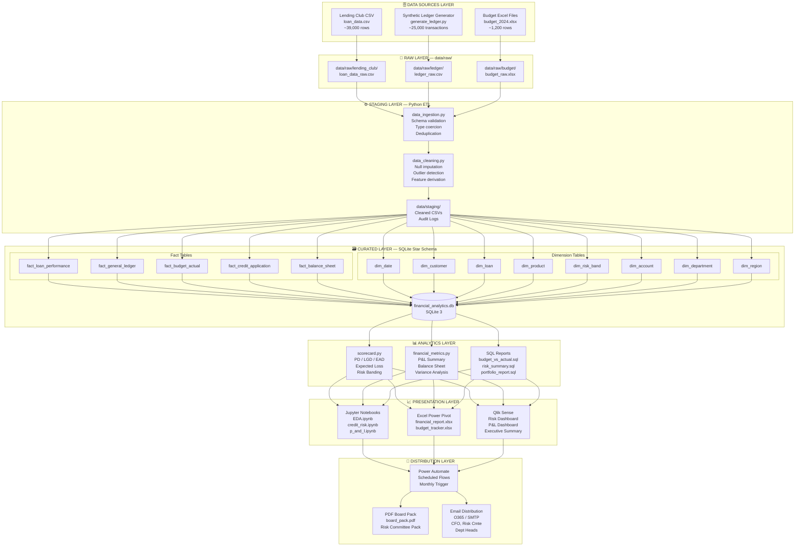

# Financial Analytics and Risk Reporting System — Architecture Diagram

## ASCII Data Pipeline Overview

```
╔══════════════════════════════════════════════════════════════════════════════════╗
║                     FINANCIAL ANALYTICS & RISK REPORTING SYSTEM                 ║
║                              Full Data Pipeline                                  ║
╠══════════════════════════════════════════════════════════════════════════════════╣
║                                                                                  ║
║  ┌──────────────────────────────────────────────────────────────────────────┐   ║
║  │  LAYER 0 — DATA SOURCES                                                  │   ║
║  │                                                                          │   ║
║  │  ┌───────────────────┐  ┌─────────────────────┐  ┌──────────────────┐   │   ║
║  │  │ Lending Club CSV  │  │ Synthetic Ledger Gen │  │ Budget Excel     │   │   ║
║  │  │ loan_data.csv     │  │ generate_ledger.py   │  │ budget_2024.xlsx │   │   ║
║  │  │ ~39,000 rows      │  │ ~25,000 transactions │  │ ~1,200 rows      │   │   ║
║  │  └────────┬──────────┘  └──────────┬──────────┘  └────────┬─────────┘   │   ║
║  └───────────│────────────────────────│────────────────────────│────────────┘   ║
║              │                        │                        │                 ║
║              ▼                        ▼                        ▼                 ║
║  ┌──────────────────────────────────────────────────────────────────────────┐   ║
║  │  LAYER 1 — RAW LAYER  (data/raw/)                                        │   ║
║  │                                                                          │   ║
║  │  data/raw/lending_club/   data/raw/ledger/     data/raw/budget/          │   ║
║  │  loan_data_raw.csv        ledger_raw.csv        budget_raw.xlsx          │   ║
║  │  (immutable, versioned)   (immutable)           (immutable)              │   ║
║  └───────────────────────────────────┬──────────────────────────────────────┘   ║
║                                      │                                           ║
║                                      ▼                                           ║
║  ┌──────────────────────────────────────────────────────────────────────────┐   ║
║  │  LAYER 2 — STAGING LAYER (Python ETL)                                    │   ║
║  │                                                                          │   ║
║  │   ┌───────────────────────┐       ┌─────────────────────────────────┐   │   ║
║  │   │   data_ingestion.py   │  ───► │       data_cleaning.py          │   │   ║
║  │   │  • Schema validation  │       │  • Null imputation              │   │   ║
║  │   │  • Type coercion      │       │  • Outlier detection            │   │   ║
║  │   │  • Deduplication      │       │  • Date normalisation           │   │   ║
║  │   │  • Row-count checks   │       │  • Feature derivation           │   │   ║
║  │   └───────────────────────┘       └─────────────────────────────────┘   │   ║
║  │                                                                          │   ║
║  │  Output: data/staging/  (cleaned CSVs, audit logs)                      │   ║
║  └───────────────────────────────────┬──────────────────────────────────────┘   ║
║                                      │                                           ║
║                                      ▼                                           ║
║  ┌──────────────────────────────────────────────────────────────────────────┐   ║
║  │  LAYER 3 — CURATED LAYER (SQLite Star Schema)                            │   ║
║  │                                                                          │   ║
║  │   FACT TABLES                   DIMENSION TABLES                        │   ║
║  │   ┌──────────────────────┐      ┌──────────┐  ┌────────────────┐        │   ║
║  │   │ fact_loan_performance│◄─────│dim_date  │  │  dim_customer  │        │   ║
║  │   │ fact_general_ledger  │◄─────│dim_loan  │  │  dim_product   │        │   ║
║  │   │ fact_budget_actual   │◄─────│dim_risk  │  │  dim_account   │        │   ║
║  │   │ fact_credit_app      │      │  _band   │  │  dim_dept      │        │   ║
║  │   │ fact_balance_sheet   │◄─────│dim_region│  │                │        │   ║
║  │   └──────────────────────┘      └──────────┘  └────────────────┘        │   ║
║  │                                                                          │   ║
║  │  File: financial_analytics.db  (SQLite 3)                               │   ║
║  └───────────────────────────────────┬──────────────────────────────────────┘   ║
║                                      │                                           ║
║                                      ▼                                           ║
║  ┌──────────────────────────────────────────────────────────────────────────┐   ║
║  │  LAYER 4 — ANALYTICS LAYER                                               │   ║
║  │                                                                          │   ║
║  │  ┌────────────────────┐  ┌──────────────────────┐  ┌────────────────┐   │   ║
║  │  │   scorecard.py     │  │ financial_metrics.py  │  │  SQL Reports   │   │   ║
║  │  │  • PD estimation   │  │  • P&L summary        │  │  budget_vs_    │   │   ║
║  │  │  • LGD modelling   │  │  • Balance sheet       │  │  actual.sql    │   │   ║
║  │  │  • EAD calculation │  │  • Cash flow           │  │  risk_summary  │   │   ║
║  │  │  • Expected Loss   │  │  • Variance analysis   │  │  .sql          │   │   ║
║  │  │  • Risk banding    │  │  • KPI dashboards      │  │                │   │   ║
║  │  └────────────────────┘  └──────────────────────┘  └────────────────┘   │   ║
║  └───────────────────────────────────┬──────────────────────────────────────┘   ║
║                                      │                                           ║
║                                      ▼                                           ║
║  ┌──────────────────────────────────────────────────────────────────────────┐   ║
║  │  LAYER 5 — PRESENTATION LAYER                                            │   ║
║  │                                                                          │   ║
║  │  ┌──────────────────┐  ┌─────────────────────┐  ┌────────────────────┐  │   ║
║  │  │ Jupyter Notebooks│  │  Excel Power Pivot   │  │    Qlik Sense      │  │   ║
║  │  │ EDA.ipynb        │  │  financial_report    │  │  Risk Dashboard    │  │   ║
║  │  │ credit_risk.ipynb│  │  .xlsx               │  │  P&L Dashboard     │  │   ║
║  │  │ p_and_l.ipynb    │  │  budget_tracker.xlsx │  │  Exec Summary      │  │   ║
║  │  └──────────────────┘  └─────────────────────┘  └────────────────────┘  │   ║
║  └───────────────────────────────────┬──────────────────────────────────────┘   ║
║                                      │                                           ║
║                                      ▼                                           ║
║  ┌──────────────────────────────────────────────────────────────────────────┐   ║
║  │  LAYER 6 — DISTRIBUTION LAYER                                            │   ║
║  │                                                                          │   ║
║  │  ┌───────────────────┐  ┌─────────────────────┐  ┌────────────────────┐ │   ║
║  │  │ Power Automate    │  │   PDF Board Pack     │  │  Email Distribution│ │   ║
║  │  │ (scheduled flows) │  │   board_pack.pdf     │  │  (SMTP / O365)     │ │   ║
║  │  │ Monthly trigger   │  │   Risk Committee     │  │  CFO, Risk Cmte,   │ │   ║
║  │  │ on report ready   │  │   Management Accounts│  │  Department Heads  │ │   ║
║  │  └───────────────────┘  └─────────────────────┘  └────────────────────┘ │   ║
║  └──────────────────────────────────────────────────────────────────────────┘   ║
╚══════════════════════════════════════════════════════════════════════════════════╝
```

---

## Mermaid Flowchart — Full System Architecture



---

## Layer Descriptions

### Layer 0 — Data Sources
This is the entry point for all raw data ingested into the system. Three distinct sources feed the pipeline: external Lending Club loan data (a publicly available CSV dataset with ~39,000 real-world loan records), a Python-based synthetic general ledger generator that produces realistic double-entry accounting transactions, and Excel-based budget files prepared by the finance team.

### Layer 1 — Raw Layer (`data/raw/`)
The raw layer stores every source file exactly as received, without modification. Files are version-controlled and timestamped; this immutable landing zone ensures that any downstream processing error can be traced back to the original source data for auditing and re-processing.

### Layer 2 — Staging Layer (Python ETL)
Two Python scripts perform all ingestion and cleansing logic. `data_ingestion.py` handles schema validation, type coercion, and deduplication, while `data_cleaning.py` performs null imputation, outlier detection, date normalisation, and derived feature construction. Cleaned outputs and row-level audit logs are written to `data/staging/`.

### Layer 3 — Curated Layer (SQLite Star Schema)
Cleaned staging data is loaded into a SQLite database using a star-schema design consisting of five fact tables and eight dimension tables. This denormalised structure optimises analytical query performance and provides a single source of truth for all downstream analytics and reporting.

### Layer 4 — Analytics Layer
Python models (`scorecard.py`, `financial_metrics.py`) and parameterised SQL scripts execute against the curated database to produce credit risk metrics (PD, LGD, EAD, Expected Loss), P&L summaries, balance sheet reconciliations, and budget-versus-actual variance analyses.

### Layer 5 — Presentation Layer
Analytical outputs are surfaced to end users via three channels: Jupyter Notebooks for ad-hoc exploration and narrative reporting, Excel workbooks with Power Pivot for finance-team self-service, and Qlik Sense dashboards for interactive executive and risk-committee visualisations.

### Layer 6 — Distribution Layer
Completed reports are packaged into a PDF Board Pack and distributed via scheduled Power Automate flows that trigger on report completion. The distribution list—CFO, Risk Committee, and Department Heads—receives reports via Office 365 email with the PDF attached.

---

## Data Flow Volumes and Formats

| Layer | Dataset | Format | Approx. Row Count | File Size | Refresh Frequency |
|-------|---------|--------|------------------:|----------:|-------------------|
| Raw | Lending Club Loans | CSV (UTF-8) | 39,717 | ~38 MB | One-time historical load |
| Raw | Synthetic Ledger | CSV (UTF-8) | 25,000 | ~6 MB | Monthly generation |
| Raw | Budget | Excel (.xlsx) | 1,200 | ~1.2 MB | Annual (with monthly revisions) |
| Staging | Cleaned Loan Data | CSV (UTF-8) | 38,942 | ~35 MB | On-demand / monthly |
| Staging | Cleaned Ledger | CSV (UTF-8) | 24,988 | ~5.8 MB | Monthly |
| Staging | Cleaned Budget | CSV (UTF-8) | 1,196 | ~0.4 MB | Monthly |
| Curated | SQLite Database | SQLite 3 | — | ~55 MB | Monthly |
| Analytics | Risk Score Output | CSV / DB view | 38,942 | ~12 MB | Monthly |
| Analytics | Financial Metrics | CSV / DB view | ~1,500 | ~0.8 MB | Monthly |
| Presentation | Excel Report | .xlsx | — | ~4 MB | Monthly |
| Presentation | PDF Board Pack | .pdf | — | ~2 MB | Monthly |
| Distribution | Email + PDF | .pdf / MIME | — | ~2 MB | Monthly |
